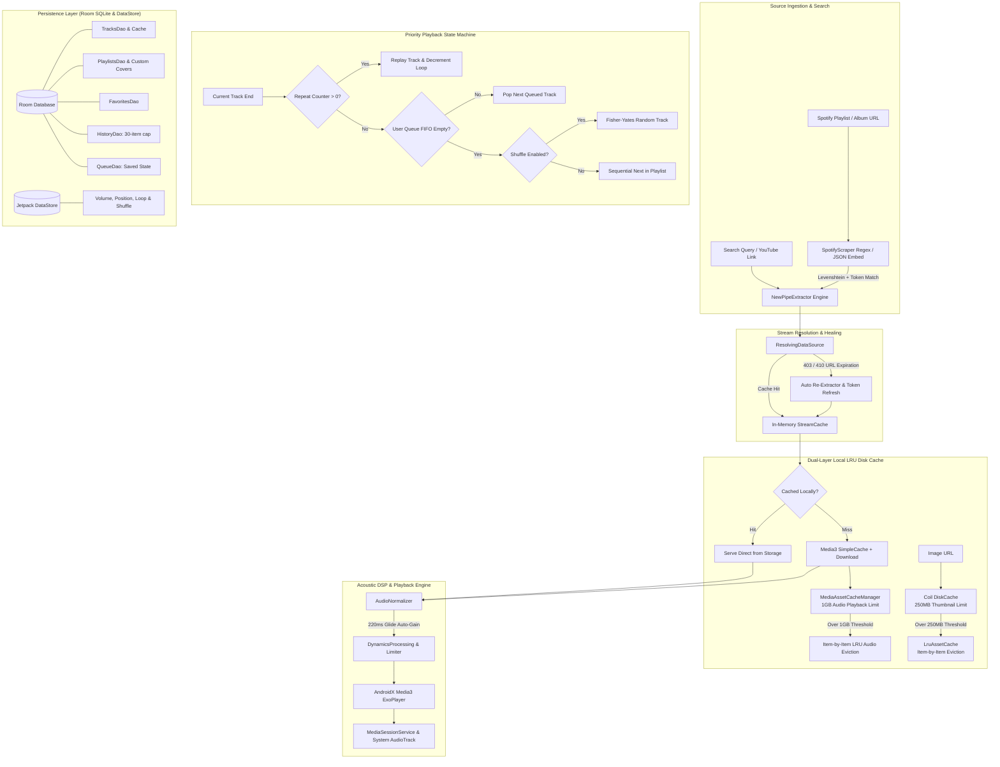

# 💀 SKULLBEAT

<p align="center">
  
</p>

<p align="center">
  <b>High-Fidelity, Zero-Ad Music Streaming Architecture for Android & PC</b><br>
  <i>Pure direct audio streaming • 80% bandwidth reduction • Zero subscription fees • Spotify & YouTube import • On-device LRU caching • Material 3 dark aesthetics</i>
</p>

<p align="center">
  <a href="https://github.com"></a>
  <a href="https://developer.android.com"></a>
  <a href="https://kotlinlang.org"></a>
  <a href="https://developer.android.com/jetpack/compose"></a>
  <a href="https://developer.android.com/media/media3"></a>
</p>

<p align="center">
  <a href="https://fastapi.tiangolo.com"></a>
  <a href="https://developer.android.com/training/data-storage/room"></a>
  <a href="https://coil-kt.github.io/coil/"></a>
  <a href="#"></a>
  <a href="LICENSE"></a>
</p>

<p align="center">
  <a href="download_apk/SkullBeat.apk"><b>📲 Download Android APK (SkullBeat.apk)</b></a> •
  <a href="PROJECT_STRUCTURE.md"><b>📖 Architecture Tree</b></a> •
  <a href="#-visual-showcase"><b>🖼️ Screenshots</b></a> •
  <a href="#-audio-engine--system-architecture"><b>⚡ Data Flow</b></a> •
  <a href="#-quick-start"><b>🚀 Quick Start</b></a>
</p>

---

## 📸 Visual Showcase

### Mobile Player Experience (Android)

| 🏠 Home Feed | 🎵 Now Playing & Dynamic Theme | 📋 FIFO Playback Queue |
| :---: | :---: | :---: |
|  |  |  |
| *Fredoka typography, 2x2 shortcuts, recently played history & personalized feeds.* | *100% opaque bottom sheet tinted by song artwork, spinning skull play/buffer indicator.* | *Dynamic FIFO priority queue, track removal, and instant status counter.* |

| 👆 Bidirectional Swipe Gestures | 📚 Library & Filter Engine | 🔔 Themed Notification Drawer |
| :---: | :---: | :---: |
|  |  |  |
| *Swipe right to enqueue instantly; swipe left for quick delete/context actions.* | *Duration range slider, chip filters, playlist photo covers & M3U/CSV exporter.* | *Dual-tone palette tinting, lock screen controls, and progress scrubbing.* |

| 🔂 Repeat Once Mode | 🔁 Repeat Twice Mode | 🚀 What's New Dialog |
| :---: | :---: | :---: |
|  |  |  |
| *Triple-state precision loop: Off, 1 extra repeat, or 2 extra repeats.* | *Live counter badge tracks loop count before resuming the user queue.* | *Integrated release notes and version changelog.* |

---

## ⚡ Audio Engine & System Architecture

SkullBeat extracts pure opus/m4a audio streams directly on-device, bypassing video encoding payloads to save up to **80% bandwidth**. Replays are served instantly from on-device fixed-limit LRU disk caches.



---

## 🌟 Key Engineering Features

### 1. 📦 Dual-Layer Fixed-Capacity LRU Disk Cache
- **1GB Audio Playback Cache**: Powered by AndroidX Media3 `SimpleCache` + `LeastRecentlyUsedCacheEvictor` wrapped in `MediaAssetCacheManager`. Pre-buffers and retains audio tracks for zero-network instant replay.
- **250MB Thumbnail Cache**: Integrated with Coil `DiskCache` using `LruAssetCache` to store album artwork and artist images locally.
- **Item-by-Item Eviction**: Enforces strict ceiling limits. When capacity is exceeded, files are evicted one by one starting from the least recently used timestamp, without touching active media.
- **Atomic Operations**: Employs UUID temporary files and atomic rename replacements to prevent half-written cache corruption during unexpected terminations.

### 2. 🎛️ Spotify-Style FIFO Queue & Priority Engine
- **Strict Precedence Hierarchy**:
  $$\text{Current Track Loop} \longrightarrow \text{User FIFO Queue} \longrightarrow \text{Playlist Context (Sequential / Shuffle)}$$
- **Non-Intrusive Enqueueing**: Adding songs via swipe or context menu never interrupts currently playing audio.
- **Queue Transparency**: Full drawer display with track counts, instant re-ordering, individual removal, and automatic resumption when empty.

### 3. 🔁 Triple-State Precision Loop Engine
- **Three Discrete Modes**:
  - `OFF`: Normal continuous progression.
  - `REPEAT ONE (🔂 1)`: Replays current track exactly 1 additional time, then seamlessly continues.
  - `REPEAT TWO (🔁 2)`: Replays current track exactly 2 additional times, then seamlessly continues.
- **Interactive Triggers**: Cycle through modes with tap gestures on mobile or desktop click controls with visible state indicator badges.

### 4. 👆 Bidirectional Haptic Swipe Gestures
- **Swipe Right (`->`)**: Instantly enqueues track into playback queue with colored pill animations and haptic confirmation.
- **Swipe Left (`<-`)**: Fast deletion / removal from playlists or queues.
- **120 FPS Response**: Optimized Compose layout using `Modifier.onSizeChanged` and `SwipeToQueueBox` eliminating frame stutter.

### 5. 🖼️ Custom Local Playlist Photo Covers
- **Standard Photo Picker**: Native Android 13+ Photo Picker integration (`ActivityResultContracts.PickVisualMedia`) with fallback to Storage Access Framework (`OpenDocument`).
- **1:1 Square Crop & Rotation**: In-app processing with EXIF orientation correction, downsampling, and persistent storage.
- **Stable Fast Scrolling**: Recycled `LazyColumn` keys and Coil memory caches guarantee crash-free flings across 1,000+ item playlists.

### 6. 🔼 Instant Prepend Playlist Ordering
- **Top Insertion**: Newly added individual songs are automatically inserted at index `0` so your latest additions appear immediately at the top.
- **Sequential Preserved Bulk Imports**: Full CSV and Spotify playlist imports retain their original track order ($1 \dots N$).

### 7. 🔊 Acoustic Loudness Normalization
- **Volume Jump Elimination**: Dynamic gain analysis standardizes volume between whisper-quiet studio tracks and loud modern bass tracks.
- **Smooth Glide**: Uses Android `DynamicsProcessing` single-band multiband compression and peak limiting with a 220ms smooth gain glide to preserve natural dynamic range without clipping.

### 8. 💻 PC Web Streamer & Terminal CLI Companion
- **FastAPI Web Server**: Responsive dark-mode single-page interface with real-time audio visualizers, playlist imports, and instant playback.
- **Terminal CLI (`filter_music.py`)**: Powerful ANSI table filter supporting multi-criteria search, duration range filtering, M3U/CSV export, and direct console streaming via `mpv`/`ffplay`.

---

## 📁 Repository Structure

```
SkullBeat/
├── android/                         # Android native project (Kotlin, Jetpack Compose, Media3)
│   ├── app/                         # App module source code & resources
│   │   ├── src/main/java/com/skullbeat/app/
│   │   │   ├── data/
│   │   │   │   ├── cache/           # [LruAssetCache.kt, MediaAssetCacheManager.kt]
│   │   │   │   ├── db/              # [AppDatabase.kt, DAOs: Tracks, Playlists, Queue, Favorites]
│   │   │   │   ├── extractor/       # [YouTubeExtractor.kt, StreamCache.kt]
│   │   │   │   ├── network/         # [OkHttpDownloader.kt, SpotifyScraper.kt]
│   │   │   │   ├── repository/      # [MusicRepositoryImpl.kt]
│   │   │   │   └── storage/         # [UserPreferences.kt]
│   │   │   ├── domain/              # [Clean architecture models, interfaces & utility parsers]
│   │   │   ├── player/
│   │   │   │   ├── audio/           # [AudioNormalizer.kt: DynamicsProcessing & Limiter]
│   │   │   │   ├── manager/         # [PlayerManager.kt, PlaybackState.kt, QueueHelper.kt]
│   │   │   │   └── service/         # [PlaybackService.kt: MediaSessionService & Notification]
│   │   │   └── ui/                  # [Compose theme, components, screens, dialogs, navigation]
│   │   └── src/test/                # [83 unit tests verifying LRU cache, filters, queue logic]
│   └── gradle/                      # Gradle build scripts & version catalogs
│
├── pc/                              # PC Python streaming engine & CLI suite
│   ├── app.py                       # FastAPI web server, WebSocket state, and audio streaming API
│   ├── filter_music.py              # Terminal CLI music player & library filtering tool
│   ├── requirements.txt             # Python dependencies (fastapi, uvicorn, yt-dlp, ytmusicapi)
│   └── run_audiotube.bat            # One-click Windows desktop server launcher
│
├── download_apk/                    # Production distribution
│   └── SkullBeat.apk                # Pre-built release APK (v1.2.7 Build 10)
│
├── pictures/                        # Visual branding & verified screenshots
│   ├── logo.png                     # Official brand emblem
│   ├── screen_home.png              # Android home feed
│   ├── screen_now_playing.png       # Now playing full sheet
│   ├── screen_queue_active.png      # Active FIFO queue
│   ├── screen_swiped.png            # Swipe-to-queue gesture
│   ├── screen_library.png           # Multi-filter library & playlist view
│   ├── screen_notification.png      # Dual-color shaded notification drawer
│   ├── screen_loop_single.png       # Repeat 1 mode indicator
│   └── screen_loop_double.png       # Repeat 2 mode indicator
│
├── PROJECT_STRUCTURE.md             # Complete parent-child file, function & component index
├── README.md                        # Master repository documentation
└── LICENSE                          # MIT License
```

---

## 🚀 Quick Start

### Android Application

#### Option A: Install Pre-Built APK
1. Download [`download_apk/SkullBeat.apk`](download_apk/SkullBeat.apk) to your Android device (Android 8.0+ / API 26+).
2. Tap the file to install (allow "Install from Unknown Sources" if prompted).

#### Option B: Build from Source
```bash
# Clone the repository
git clone https://github.com/your-username/SkullBeat.git
cd SkullBeat/android

# Build Debug APK
./gradlew assembleDebug

# Output location:
# android/app/build/outputs/apk/debug/app-debug.apk
```

#### Run Android Unit Tests (83 Tests)
```bash
cd android
./gradlew testDebugUnitTest
```

---

### PC Web Player & Ubuntu Linux Support

#### Ubuntu Linux Quick Start (One-Click)
```bash
cd pc
chmod +x install_ubuntu.sh run_skullbeat.sh
./install_ubuntu.sh
```
*Creates application icon in Ubuntu Dash and starts streaming at [http://localhost:8000](http://localhost:8000).*

#### Manual Environment Setup
```bash
cd pc
python3 -m venv .venv
# Ubuntu / Linux / macOS:
source .venv/bin/activate
# Windows:
.venv\Scripts\activate

pip install -r requirements.txt
```

#### Launch Web Player
```bash
# Ubuntu Linux:
./run_skullbeat.sh

# Windows:
run_audiotube.bat

# Direct python:
python3 app.py
```
Open your browser at [http://localhost:8000](http://localhost:8000).

#### 3. Run Terminal CLI Player
```bash
# Search and play directly in console:
python filter_music.py --query "synthwave" --play 1

# Filter personal YouTube Music library by artist:
python filter_music.py --source liked --artist "Skillet"

# Filter by duration (2 to 5 minutes) and export to CSV:
python filter_music.py --min-duration 120 --max-duration 300 --export filtered.csv
```

---

## 🎨 Theme Presets & Custom Aesthetics

SkullBeat includes dynamic neon theme customization available on first launch and anytime inside the application:

| Theme | Key | Accents | Description |
| :--- | :--- | :--- | :--- |
| **Default (Original)** | `default` | Neon Blue & Violet (`#3D8BFF`, `#8B5CFF`, `#00D4FF`) | The primary classic SkullBeat aesthetic |
| **Cyber Cyan** | `cyan` | Neon Aqua & Cyan (`#00B8D4`, `#00F5FF`) | Futuristic cyberpunk teal vibe |
| **Sapphire Blue** | `blue` | Deep Royal & Cobalt (`#1565C0`, `#2979FF`) | Ocean deep cobalt aesthetic |
| **Matrix Green** | `green` | Emerald & Mint (`#00C853`, `#00E676`) | Toxic neon green glow |
| **Neon Violet** | `purple` | Ultraviolet & Magenta (`#7B2CBF`, `#9D4EDD`) | Synthwave neon amethyst vibe |
| **Crimson Skull** | `red` | Blood Red & Ruby (`#D90429`, `#FF2E55`) | Fiery crimson red aesthetic |
| **Sunset Gold** | `amber` | Warm Amber & Gold (`#E85D04`, `#FF9E00`) | Warm sunset solar glow |

- **Startup Prompt**: Shown once upon initial application start so users can personalize their vibe immediately.
- **Inside App Selector**: Accessible at any time via the sidebar `Theme` button (PC Web) or top header `Palette` button (Android).
- **Persistent Storage**: Saved in local storage / Android preferences and restored seamlessly across sessions without reload.

---

## 🎨 Design Tokens & Palette (60-25-10-5 Rule)

| Role | Share | Hex Token | Swatch | Description |
| :--- | :---: | :---: | :---: | :--- |
| **Dominant Canvas** | 60% | `#070B16` | `■` | Ultra-deep abyssal navy background |
| **Surface Cards & Sheets** | 25% | `#0F1830` | `■` | Elevated container surfaces, sheets & dialog cards |
| **Text & Glyph Content** | 10% | `#EAF0FF` | `■` | High-contrast bone white primary typography |
| **Secondary Metadata** | — | `#8A96B8` | `■` | Subdued blue-gray for artists, timestamps, durations |
| **Interactive Accent** | 5% | `#2F7BFF` | `■` | Electric neon blue for active states, sliders, glowing skull |

---

## 🧪 Test Verification & Quality Assurance

The codebase includes an extensive suite of automated unit tests covering all mission-critical data structures, caching rules, and audio algorithms:

| Test Suite | File | Verified Invariants |
| :--- | :--- | :--- |
| **LRU Disk Eviction** | `LruAssetCacheTest.kt` | Item-by-item LRU eviction, capacity threshold enforcement, atomic writes, eviction ordering. |
| **Time Formatting** | `TimeUtilsTest.kt` | `mm:ss` string conversion, ISO-8601 duration parsing, millisecond boundary rounding. |
| **Library Filters** | `TrackFilterTest.kt` | Artist/Title/Album case-insensitive substrings, duration range min/max bounds. |
| **Queue & Shuffle** | `QueueHelperTest.kt` | Fisher-Yates non-repeating shuffle generation, sequence continuity, FIFO ordering. |
| **History Deduplication** | `HistoryRuleTest.kt` | Strict 30-item ceiling limit, top-ordering prepend, duplicate bump prevention. |
| **Spotify Scraper** | `SpotifyParserTest.kt` | Embed HTML parsing, script extraction, JSON payload fallback. |

Run all tests via:
```bash
./gradlew testDebugUnitTest
```

---

## 📜 License

Distributed under the **MIT License**. See [`LICENSE`](LICENSE) for full details.
